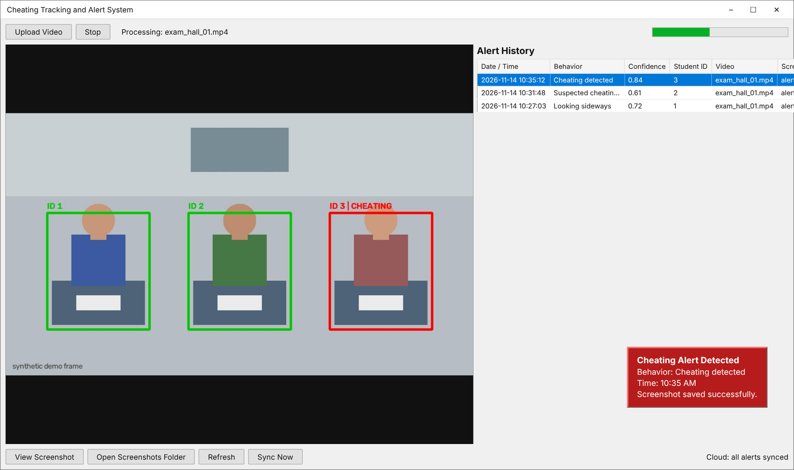
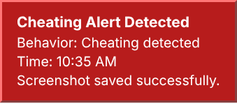
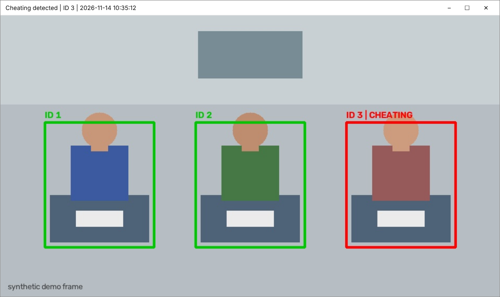
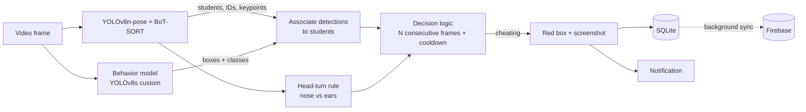

# Cheating Tracking and Alert System

A desktop application that watches exam videos, tracks every student, detects suspicious behavior with a
YOLOv8 model, and raises an alert the moment cheating is detected: the student's box turns **red**, a
**screenshot** is saved, the incident is stored in a **database**, and a **desktop notification** is shown.

> Built as Sprint 2 / Project 3 (Cheating Tracking and Alert System). Detection model trained on a custom
> Roboflow dataset (`exam-cheating-dataset`), app built with **Tkinter**, storage in **SQLite** with optional
> **Firebase Firestore / Storage** sync.

---

## Table of contents

- [Features](#features)
- [Screenshots](#screenshots)
- [How it works](#how-it-works)
- [Detection classes](#detection-classes)
- [Model performance](#model-performance)
- [Project structure](#project-structure)
- [Installation](#installation)
- [Getting the models](#getting-the-models)
- [Usage](#usage)
- [Configuration](#configuration)
- [Firebase (optional)](#firebase-optional)
- [Training the model](#training-the-model)
- [Testing](#testing)
- [Known limitations](#known-limitations)
- [License](#license)

---

## Features

| Requirement | Implementation |
|---|---|
| Track students in exam video | YOLOv8-pose with BoT-SORT tracking (persistent ID per student) |
| Detect cheating behavior | Custom YOLOv8s model + rule-based "looking sideways" detector |
| Red box for cheating, green for normal | Drawn on the tracked student, held for a few seconds after the alert |
| Screenshot on cheating | Saved to `alerts/screenshots/` after the red box is drawn |
| Save incident details | SQLite (works offline): time, behavior, confidence, track ID, video, frame, screenshot path |
| Desktop app | Tkinter: Upload Video, Stop, live preview, alert history |
| Notification | In-app toast + system notification (`plyer`) |
| Screenshot viewer | "View Screenshot" and "Open Screenshots Folder" buttons |
| Cloud database (optional) | Firebase Firestore for records, Firebase Storage for screenshots |
| App icon | `assets/icon.ico` / `assets/icon.png` |

Extra behavior worth knowing about:

- **Consecutive-frame rule:** an alert needs N frames in a row (10 by default, 15 for `suspected cheating`),
  so single-frame mistakes don't trigger alerts.
- **Per-student cooldown:** the same student is not alerted again for 30 seconds.
- **Offline-first sync:** every alert is saved locally first; a background worker uploads it to Firebase and
  retries when the network is back, so a connection drop never loses an alert or blocks detection.
- **Responsive UI:** video runs in a worker thread, models load lazily, so the window opens instantly.

## Screenshots

> These are **illustrative previews rendered with synthetic demo data** (cartoon figures, no real students or
> real detections). Replace them with real captures from your own runs; the file names are
> `docs/screenshots/main_window.png`, `alert_notification.png` and `screenshot_viewer.png`.

**Main window:** live preview with green (normal) and red (cheating) boxes, progress bar, and alert history.



**Notification** shown the moment an alert fires:



**Screenshot viewer** (select an alert, then "View Screenshot"):



## How it works



1. **Pose + tracking.** `yolov8n-pose` detects each person and gives a stable track ID plus body keypoints.
2. **Behavior detection.** A custom-trained YOLOv8s detects `cheating`, `suspected cheating` and `normal`.
3. **Association.** A detection that overlaps a tracked student's box (IoU >= 0.3) belongs to that student.
   A small box (hand or paper) is assigned to the student whose wrist is closest.
4. **Head-turn rule.** The nose position relative to the ears (or shoulders) flags "Looking sideways"
   without any extra training. Looking down at your own paper is not flagged.
5. **Decision.** A behavior must persist for N consecutive processed frames before it becomes an alert.
6. **Output.** Red box, screenshot, database row, notification, optional cloud sync.

## Detection classes

The Roboflow dataset has three classes:

| Class | Raises an alert? | Rule |
|---|---|---|
| `cheating` | Yes | 10 consecutive frames |
| `suspected cheating` | Yes | 15 consecutive frames (largest and most ambiguous class, so it needs more evidence) |
| `normal` | No | Ignored by the detector |
| *(rule-based)* Looking sideways | Yes | 20 consecutive frames |

The class list, alert labels and per-class rules live in `config.json` (`cheating_classes`,
`behavior_labels`, `behavior_rules`) and are overridden by `models/model_info.json` produced by the training
notebook.

## Model performance

Trained for 80 epochs on a Tesla T4 (YOLOv8s, 640 px). Results on the **test split after removing duplicate
images across splits** (the original random split leaked near-identical images between train and test, which
inflated mAP50 to 0.78; the numbers below are the honest ones):

| Class | Precision | Recall | AP50 | AP50-95 |
|---|---|---|---|---|
| cheating | 0.74 | 0.70 | 0.72 | 0.46 |
| normal | 0.57 | 0.58 | 0.60 | 0.33 |
| suspected cheating | 0.61 | 0.72 | 0.67 | 0.34 |
| **all** | **0.64** | **0.67** | **0.66** | **0.38** |

The test split contains only 177 `cheating` boxes, so the per-class numbers move easily. The dataset has
5,447 images but only about 2,600 unique scenes, so more varied data is the most effective way to improve
accuracy. The consecutive-frame rule makes the live system more reliable than the per-frame numbers suggest.

## Project structure

```
cheating_project/
├── .gitignore
├── LICENSE                          # MIT
├── README.md
├── config.json                      # thresholds, colors, paths, Firebase settings
├── requirements.txt
├── main.py                          # Tkinter app entry point
├── run_video.py                     # quick test on a video file (no UI)
├── make_icon.py                     # regenerates assets/icon.ico and icon.png
│
├── core/                            # detection and decision logic (no UI code)
│   ├── __init__.py
│   ├── config.py                    # loads config.json, merges models/model_info.json
│   ├── detector.py                  # pose + tracking + behavior model
│   ├── pipeline.py                  # frame -> detect -> decide -> draw -> screenshot + DB
│   ├── cheating_logic.py            # association, consecutive-frame streaks, cooldown
│   ├── head_pose.py                 # rule-based "looking sideways" detector
│   └── screenshot.py                # saves the annotated frame
│
├── db/                              # storage
│   ├── __init__.py
│   ├── local_db.py                  # SQLite (offline, source of truth)
│   ├── sync.py                      # background offline-first sync worker
│   └── firebase_client.py           # Firestore + Storage wrapper
│
├── ui/
│   ├── __init__.py
│   └── app.py                       # Tkinter app (worker thread + queue)
│
├── models/                          # trained weights go here (git-ignored)
│   └── .gitkeep
├── alerts/
│   └── screenshots/                 # saved alert screenshots (git-ignored)
│       └── .gitkeep
├── assets/
│   ├── icon.ico
│   └── icon.png
├── firebase/
│   └── README.md                    # Firebase setup steps
├── notebooks/
│   └── cheating-tracking-yolov8s-training.ipynb   # Kaggle training notebook (with results)
├── docs/
│   └── screenshots/
│       ├── main_window.png
│       ├── alert_notification.png
│       └── screenshot_viewer.png
└── tests/
    ├── test_logic.py                # association, streaks, cooldown
    ├── test_head_and_pipeline.py    # head-turn rule, config merge, pipeline behavior
    ├── test_sync.py                 # offline-first sync
    └── ui_smoke.py                  # Tkinter smoke test with a stub pipeline
```

## Installation

Requires **Python 3.9+** (Tkinter ships with the standard Windows/macOS installers; on Debian/Ubuntu run
`sudo apt install python3-tk`).

```bash
git clone https://github.com/<your-username>/cheating_project.git
cd cheating_project
python -m venv .venv
source .venv/bin/activate        # Windows: .venv\Scripts\activate
pip install -r requirements.txt
```

## Getting the models

The weights are not stored in the repository. Train them with the Kaggle notebook (see
[Training the model](#training-the-model)), then:

> **Download the trained models from the Kaggle notebook output:**
> [kaggle.com/code/badrhishamzahran/cheating-tracking-yolov8s-training](https://www.kaggle.com/code/badrhishamzahran/cheating-tracking-yolov8s-training)
> (open the notebook, then the **Output** tab, and download `project_export.zip`).

1. Download `project_export.zip` from the notebook's **Output** tab (link above) and unzip it.
2. Copy everything inside its `models/` folder into this project's `models/` folder:

```
models/
├── behavior_best.pt     # custom behavior detector
├── yolov8n-pose.pt      # pretrained pose model
└── model_info.json      # class names, alert labels, rules (merged into config.json automatically)
```

## Usage

**Desktop app**

```bash
python main.py
```

1. Click **Upload Video** and pick an exam video.
2. Watch the live preview: green boxes are normal, a red box marks a student who triggered an alert.
3. Each alert pops up a notification and appears in **Alert History** with time, behavior, confidence and
   screenshot path.
4. Select a row and click **View Screenshot**, or **Open Screenshots Folder**. **Sync Now** pushes pending
   alerts to Firebase when enabled.

**Quick test without the UI**

```bash
python run_video.py path/to/video.mp4              # press q to quit
python run_video.py path/to/video.mp4 --save out.mp4
```

## Configuration

Everything is in `config.json`. The most useful settings:

| Key | Default | Meaning |
|---|---|---|
| `thresholds.behavior_conf` | 0.35 | Minimum confidence for the behavior model. Raise (0.5) for fewer false alerts, lower (0.25) to catch more |
| `thresholds.person_conf` | 0.3 | Minimum confidence for person detection |
| `decision.consecutive_frames` | 10 | Frames in a row needed before an alert |
| `decision.cooldown_seconds` | 30 | Minimum time between alerts for the same student |
| `decision.hold_red_seconds` | 3 | How long the box stays red after an alert |
| `decision.person_box_min_iou` | 0.3 | Overlap needed to attribute a box to a tracked student |
| `decision.phone_wrist_max_dist_ratio` | 0.6 | Max wrist distance (relative to student height) for small boxes |
| `behavior_rules` | `suspected cheating`: 15 | Per-behavior override of frames/cooldown |
| `head_turn.*` | enabled | Thresholds for the "looking sideways" rule; set `debug_overlay: true` to tune them |
| `process_every_n_frames` | 2 | Process every Nth frame (raise for speed on slow machines) |
| `imgsz` | 960 | Inference image size |
| `tracker` | `botsort.yaml` | Use `bytetrack.yaml` for ByteTrack |
| `firebase.enabled` | false | Turn cloud sync on |

## Firebase (optional)

Disabled by default; the app is fully functional with SQLite only. To enable:

1. Create a Firebase project and a Firestore database.
2. Generate a service account key and save it as `firebase/serviceAccountKey.json` (**never commit it**; it is in
   `.gitignore`).
3. Set `"firebase": {"enabled": true, ...}` in `config.json`.
4. On the free Spark plan (no Cloud Storage) set `"upload_screenshots": false`: records go to Firestore and
   screenshots stay on disk.

Full steps: [`firebase/README.md`](firebase/README.md).

## Training the model

Training is done in the Kaggle notebook [`notebooks/cheating-tracking-yolov8s-training.ipynb`](notebooks/cheating-tracking-yolov8s-training.ipynb):

1. Add a Kaggle Secret named `ROBOFLOW_API_KEY`, set the accelerator to GPU and Internet to On.
2. Run the notebook: it downloads the Roboflow dataset, checks for leakage between splits, **re-splits by
   scene** so duplicate images never cross splits, trains YOLOv8s, evaluates on the test split, and exports
   `project_export.zip`.
3. To improve accuracy, try `yolov8m.pt`, `IMGSZ = 960`, or add images from new rooms and camera angles.

## Testing

```bash
python -m pytest tests                 # decision logic, head-turn rule, pipeline, sync (20 tests)
python tests/ui_smoke.py               # Tkinter smoke test with a stub pipeline (no models needed)
```

## Known limitations

- Detection accuracy is moderate (mAP50 0.66 on a leak-free test split). Always have a human review the
  screenshots; the system flags, it does not decide.
- `suspected cheating` and `normal` overlap visually, so false alerts are possible.
- The head-turn rule cannot catch eye-only glances and can be fooled by hair covering the ears.
- Tuned for the dataset's camera styles; very different rooms may need threshold tuning.
- Videos are processed offline from a file; live camera input is not implemented yet.

## License

Released under the [MIT License](LICENSE). Copyright (c) 2026 BadrHishamZahran.
